  

I build things end to end and care about three areas: **artificial intelligence**, **cybersecurity**, and **shipping real projects**. Mostly TypeScript, from the interface down to the database.

  

  

  <b>Stack</b>&nbsp;&nbsp;TypeScript · React · Next.js · Node.js · Prisma · SQLite · Electron · PixiJS · Tailwind CSS · Vitest · Playwright

