  

I build things end to end and care about three areas: **artificial intelligence**, **cybersecurity**, and **shipping real projects**. Mostly TypeScript, from the interface down to the database.

  

  

  Open source: <a href="https://github.com/goonnnn0101/limpiar-metadatos-ia"><b>limpiar-metadatos-ia</b></a> — strip metadata from documents and images, entirely in the browser.

  

