<p align="center">
  
</p>

<p align="center">
  <a href="https://goonnnn0101.github.io/goonnnn0101/"><code>▶ PLAY THE INTERACTIVE VERSION — Clawd follows your cursor</code></a>
</p>

```console
goonnnn0101@github:~$ cat about.txt
I like building things end to end: a game that turns the Windows desktop
into a level, an e-commerce admin with its own analytics engine, and an
AI video SaaS. Mostly TypeScript, from the UI down to the database.
```

<p align="center">
  
</p>

> `SRC: PRIVATE` — the code for these projects is not public. Happy to walk through any of them in a call or share access on request.

<p align="center">
  
</p>

```console
goonnnn0101@github:~$ ./contact.sh
> open an issue on this repo, or reach me through the links on my profile
> INSERT COIN TO CONTINUE_
```
